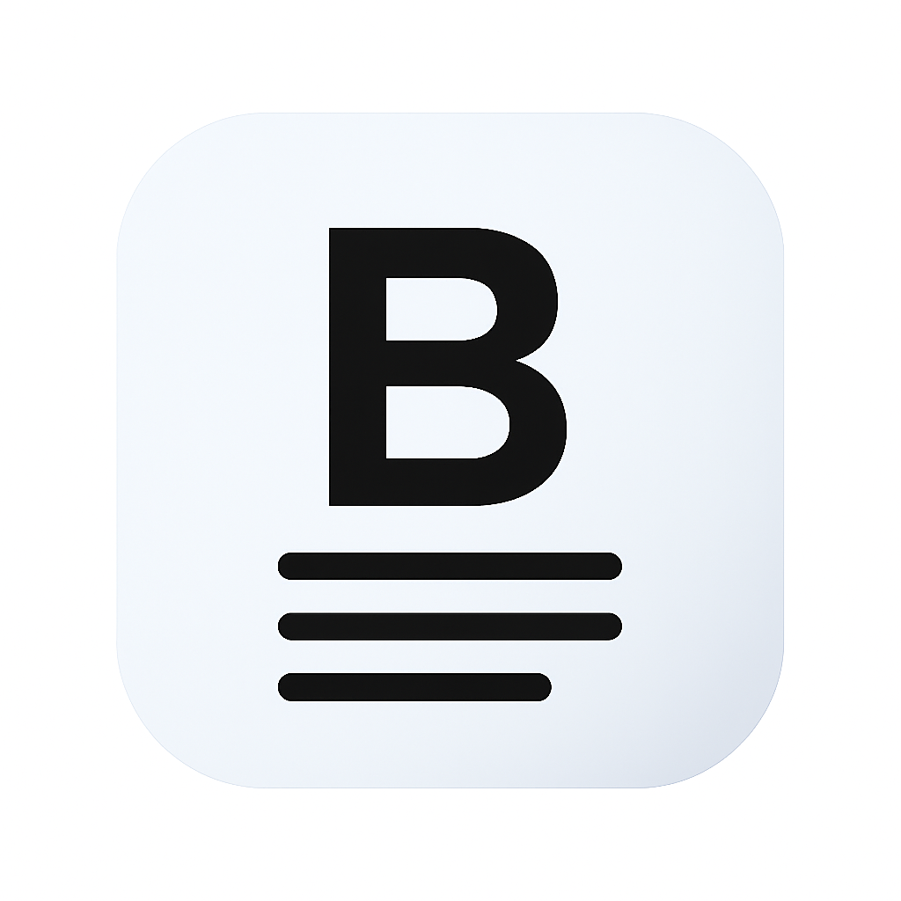

<p align="center">
  
</p>

<h1 align="center">Barruu</h1>

<p align="center">
  <strong>Build Knowledge. Make It Interactive.</strong>
</p>

<p align="center">
  <a href="https://github.com/Barruuapps/barruu/blob/main/LICENSE"></a>
  <a href="https://github.com/Barruuapps/barruu/actions"></a>
  <a href="https://github.com/Barruuapps/barruu/releases"></a>
  <a href="CODE_OF_CONDUCT.md"></a>
  <a href="https://discord.gg/MtUgbVYMw"></a>
</p>

---

## Overview

**Barruu** is an offline-first, block-based knowledge and interactive content platform built with Flutter and Rust. It enables users to create rich documents, educational books, notes, databases, and interactive learning experiences using a modern block editor.

Barruu is not just another note-taking application — it is an open-source platform for creating **interactive knowledge**. Think of it as the love child of Notion's block editor and a learning management system, built from the ground up to be extensible, private, and community-driven.

## Features

### Core Editor

- **Block-based editing** — Paragraphs, headings, lists, quotes, code blocks, and more
- **Rich text formatting** — Bold, italic, underline, strikethrough, links, and inline code
- **Drag-and-drop** — Reorder blocks intuitively
- **Slash commands** — Quick insertion of any block type with `/`
- **Offline-first** — All data stored locally. No internet required.

### Interactive Blocks

- **Quiz blocks** — Create multiple-choice, fill-in-the-blank, and matching questions
- **Graph blocks** — Embedded chart and graph visualization
- **Math blocks** — LaTeX-powered mathematical expressions
- **Code blocks** — Syntax highlighting for 50+ languages with execution support (planned)
- **Drawing blocks** — Sketch and hand-draw diagrams
- **Stepper blocks** — Step-by-step tutorials and walkthroughs
- **Audio reader blocks** — Inline audio playback with transcripts

### Knowledge Platform

- **Workspace organization** — Group documents into workspaces
- **Export** — PDF, Markdown, HTML, and more (planned)
- **Search** — Full-text search across all documents
- **Templates** — Reusable document templates (planned)
- **Plugin system** — Extend with custom block types (planned)

### Cross-Platform

- **Desktop** — Linux, macOS, Windows
- **Mobile** — Android, iOS
- **Web** (planned)

## Screenshots

<p align="center">
  <sub><em>Screenshots coming soon! If you'd like to contribute screenshots, please see <a href="CONTRIBUTING.md">CONTRIBUTING.md</a>.</em></sub>
</p>

| Editor | Blocks |
|:------:|:------:|
|  |  |

| Desktop | Mobile |
|:-------:|:------:|
|  |  |

## Architecture

Barruu follows a clean architecture pattern with feature-based modules:

```text
lib/
├── core/                  # Shared core utilities, theme, providers
│   ├── config/            # App configuration
│   ├── constants/         # Design tokens, UI constants
│   ├── errors/            # Error handling
│   ├── models/            # Shared domain models
│   ├── providers/         # Riverpod providers
│   ├── services/          # Core services (AI, storage, etc.)
│   ├── theme/             # Theming system
│   ├── utils/             # Utility functions
│   └── widgets/           # Shared UI components
├── features/              # Feature modules
│   ├── ai/                # AI assistant features
│   ├── auth/              # Authentication
│   ├── home/              # Home screen
│   ├── learning/          # Learning & quiz features
│   ├── onboarding/        # User onboarding
│   └── workspace/         # Document workspace & editor
│       ├── data/          # Data layer (repositories, sources)
│       ├── domain/        # Domain models & logic
│       └── presentation/  # UI layer (screens, widgets, blocks)
└── router/                # GoRouter configuration
```

### Technology Stack

| Layer          | Technology                                      |
|--------------- |-------------------------------------------------|
| **Frontend**   | Flutter, Riverpod, GoRouter, Freezed            |
| **Backend**    | Rust (planned), SQLite (offline), Sqflite       |
| **Storage**    | Local-first with SQLite                         |
| **Rendering**  | Flutter's Impeller engine                       |
| **State**      | Riverpod (functional reactive state management) |
| **Code Gen**   | build_runner, freezed, json_serializable         |

## Installation

### Prerequisites

- [Flutter SDK](https://flutter.dev/docs/get-started/install) (>= 3.8.1)
- [Android Studio](https://developer.android.com/studio) or [VS Code](https://code.visualstudio.com/)
- For iOS: [Xcode](https://developer.apple.com/xcode/) (macOS only)
- For Linux desktop: GTK 3.0 development libraries
- For Windows: Visual Studio 2022 with C++ desktop workload

### Development Setup

```bash
# Clone the repository
git clone https://github.com/Barruuapps/barruu.git
cd barruu

# Install dependencies
flutter pub get

# Generate code (freezed, json_serializable)
dart run build_runner build --delete-conflicting-outputs

# Run on desktop
flutter run -d linux    # Linux
flutter run -d macos    # macOS
flutter run -d windows  # Windows

# Run on mobile
flutter run -d android  # Android
flutter run -d ios      # iOS
```

### Environment Configuration

Copy `.env.example` to `.env` and configure your environment variables:

```bash
cp .env.example .env
```

## Development

### Code Generation

Barruu uses code generation extensively. After making model changes, regenerate:

```bash
dart run build_runner build --delete-conflicting-outputs
```

For watch mode during development:

```bash
dart run build_runner watch --delete-conflicting-outputs
```

### Running Tests

```bash
flutter test
```

### Code Quality

```bash
# Dart analysis
flutter analyze

# Format code
dart format lib/
```

## Roadmap

See [ROADMAP.md](ROADMAP.md) for the full roadmap.

### Phase 1 — Core Editor (Current)

- [x] Rich text block editor
- [x] Flutter desktop support (Linux, macOS, Windows)
- [x] Flutter mobile support (Android, iOS)
- [x] Offline-first SQLite storage
- [x] Slash command insertion

### Phase 2 — Interactive Blocks

- [ ] Quiz & assessment blocks
- [ ] Drawing/sketch blocks
- [ ] Code execution blocks
- [ ] Math rendering (LaTeX)
- [ ] Export to PDF, Markdown, HTML

### Phase 3 — Platform & Ecosystem

- [ ] AI assistant
- [ ] Cloud synchronization
- [ ] Block marketplace
- [ ] Plugin API
- [ ] Templates marketplace
- [ ] Collaborative editing (CRDT-based)

## Contributing

We welcome contributions! Please see [CONTRIBUTING.md](CONTRIBUTING.md) for detailed guidelines.

### Quick Start for Contributors

1. Fork the repository
1. Create a feature branch (`git checkout -b feat/amazing-feature`)
1. Make your changes
1. Run tests (`flutter test`)
1. Run the linter (`flutter analyze`)
1. Commit following [Conventional Commits](https://www.conventionalcommits.org/)
1. Push and open a Pull Request

## Community

- [Discord Server](https://discord.gg/MtUgbVYMw) — Chat with the community
- [Website](https://www.barruu.com/) — Official Barruu website
- [GitHub Discussions](https://github.com/Barruuapps/barruu/discussions) — Questions & ideas
- [Issue Tracker](https://github.com/Barruuapps/barruu/issues) — Report bugs & request features

## License

Barruu is licensed under the **GNU Affero General Public License v3.0 (AGPL-3.0)**.

This means:

- ✅ You can use Barruu for any purpose
- ✅ You can study how Barruu works and modify it
- ✅ You can distribute copies of Barruu
- ⚠️ If you run a modified version on a server (e.g., as a web service), you **must** make the modified source code available to users of that service under the AGPL
- ⚠️ Any derivative works must also be licensed under AGPL-3.0

See [LICENSE](LICENSE) for the full legal text.

### Why AGPL?

We chose AGPL to ensure that Barruu remains free and open for everyone. If someone improves Barruu and makes it available as a network service, the improvements must flow back to the community. This protects the project's long-term viability as a public good.

---

<p align="center">
  <sub>Built with ❤️ by the Barruu community</sub>
</p>
